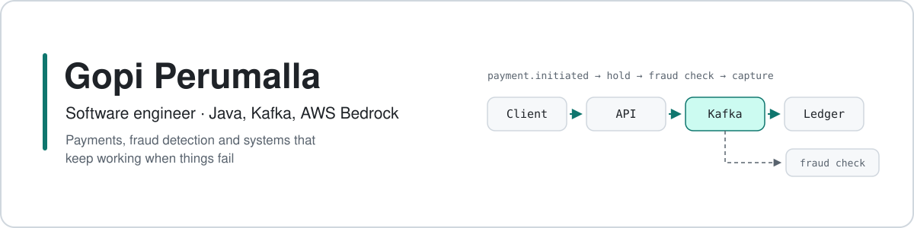
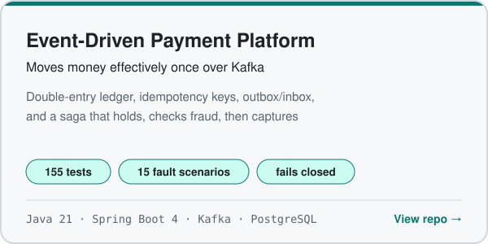
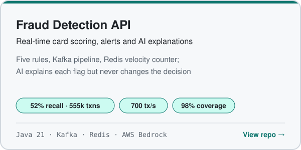
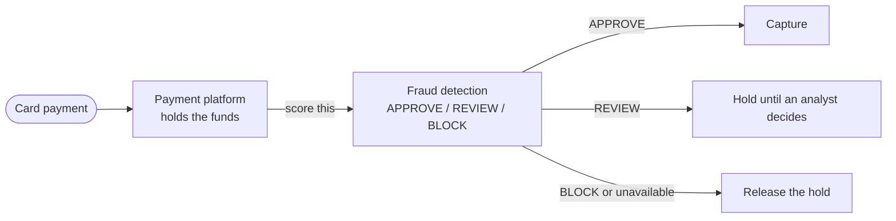

<picture>
  <source media="(prefers-color-scheme: dark)" srcset="assets/banner-dark.svg">
  
</picture>

  
  
  

> [!NOTE]
> **Looking for:** Software engineering roles (Java, Spring Boot, GenAI on AWS) in any industry.
> Based in Cincinnati, OH and open to relocation.

## About me

I'm a software engineer specializing in Java and Spring Boot, with experience building and supporting production systems in banking and healthcare.
At Deloitte I built loan payment services for a banking client that post around 150K payments a day. At CloudWave I build Spring Boot services and
Angular pages for a healthcare hosting portal, and practical AI tooling, including a Java MCP server on AWS Bedrock.

The two projects below are built the way I'd want production code to be: measured, tested against failure, and honest about their limits.

## Featured projects

<table>
<tr>
<td width="50%" valign="top">
<a href="https://github.com/PerumallaSG2/event-driven-payment-platform">
<picture>
  <source media="(prefers-color-scheme: dark)" srcset="assets/card-payments-dark.svg">
  
</picture>
</a>

- Three Spring Boot services: payment API, saga orchestrator, double-entry ledger
- Transactional outbox and inbox, so Kafka's at-least-once delivery never moves money twice
- Fault tests kill services mid-payment and pause Kafka; every run ends in a clean reconciliation

</td>
<td width="50%" valign="top">
<a href="https://github.com/PerumallaSG2/fraud-detection">
<picture>
  <source media="(prefers-color-scheme: dark)" srcset="assets/card-fraud-dark.svg">
  
</picture>
</a>

- Five rules (amount spike, velocity, impossible travel, risky merchant, odd hours) and analyst alerts
- Load-tested with k6: 700 transactions/s for 5 minutes, median 2 ms to a decision, on a laptop
- Replayed 555k labeled transactions: half of all fraud flagged for review at an 8% false-positive rate

</td>
</tr>
</table>

### How they work together

## Experience

**Software Engineer · CloudWave** · Nov 2025 – Present
Java and Spring Boot backend of a customer portal hospital IT teams use to check uptime, backups and disaster-recovery status.

- Built a backup verification check that flags failed or missed nightly jobs before the morning shift
- Built Angular status pages (backup history, DR tests, open tickets) with Redis caching on the Spring Boot APIs
- Helped migrate services from Spring Boot 2.7 to 3.x (Jakarta, Spring Security 6, Hibernate 6)
- Built a Java MCP server with Spring AI giving an AWS Bedrock assistant three read-only tools, each call permission-checked and logged
- Added runbook search with embeddings and OpenSearch so answers link back to the source

**Software Engineer · Deloitte** · Jun 2020 – Aug 2024
Loan servicing platform for a banking client: around 150K payments (about $80M) a day.

- Kafka producers and consumers for postings, reversals and late fees, with idempotent consumers and retry / dead-letter topics that nearly eliminated duplicate postings
- REST APIs for payment scheduling, payoff quotes and status, used by 6 other systems and the customer website
- Redis cache on the busiest lookups: ~800 ms down to under 100 ms
- End-of-day Spring Batch run cut from ~5 hours to under 2
- Daily reconciliation job against the general ledger; breaks reported to finance dropped by more than half
- L2/L3 production support; Resilience4j circuit breakers and Splunk alerts kept services at 99.9% uptime

## Education

**MS in Computer Science** · University of Cincinnati · Aug 2024 – Apr 2026

## Tech stack

**Backend**
 

**Messaging and data**
 

**AI**
 

**Cloud, DevOps and observability**
 

